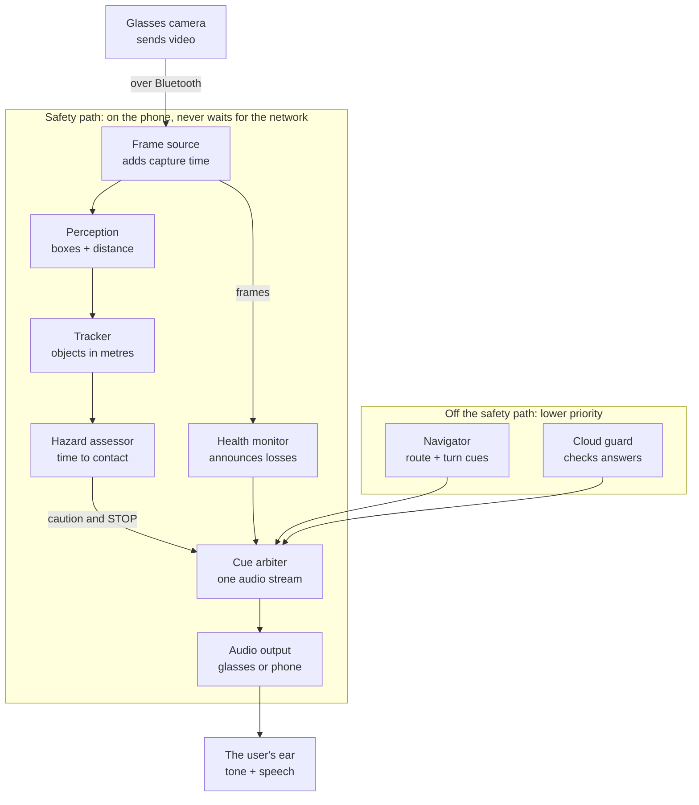

# GuideGlass prototype: architecture explained

2026-11-12. A plain-language tour of what was built on branch `av-prototype`. For the full account of results and caveats see [FINAL_REPORT.md](FINAL_REPORT.md); for design decisions see [01-architecture.md](01-architecture.md) and [adr/](adr/).

## What the prototype is

GuideGlass is a research prototype of a walking aid for blind and low-vision people: camera glasses send video to a phone, and the phone speaks short warnings and turn cues. So far only the decision logic is built and tested, in simulation. It has not run on glasses, on a phone or with any person, and it would only ever supplement a cane or guide dog.

The design borrows from self-driving cars in three ways. Urgent warnings come from a fast pipeline on the phone that never waits on the network. A separate monitor says out loud when the system cannot see. And the cloud model is only advisory: a guard decides what, if anything, of its answers the user may hear.

## The big picture

Hazard cues run along the top and down into the cue arbiter. The health monitor watches the stream and speaks when the system cannot see. Navigation and the cloud guard can only add lower-priority cues.

## The parts of the safety path

Seven parts make up the safety path, and none of them uses the network. Together they turn video frames into warnings and into messages about the system's own health.

| Part | What it does | Code |
|---|---|---|
| Frame source | Delivers each frame with the time it was captured. In the prototype this is a synthetic world; on hardware it would be the glasses through Meta's toolkit, which is not written yet. | `core/.../sim/World.kt` |
| Perception | For each object gives a box, a class and a distance with its error. Distance combines where the object meets the ground with a depth model. Both are simulated stand-ins here. | `core/.../perception/Ranger.kt` |
| Tracker | Follows objects in metres relative to the walker. A track lives for seconds, not frames, so it behaves the same at 7, 15 or 30 frames per second. It compensates for head turns. | `core/.../Tracker.kt` |
| Hazard assessor | Works out time to contact two ways: distance over walking speed for still objects, and measured closing speed for moving ones. Raises a caution at 4.0 s and a STOP at 2.5 s, once per approach. | `core/.../HazardAssessor.kt` |
| Health monitor | Watches frames, the Bluetooth link and the audio route, and announces when the system cannot see or cannot be heard. | `core/.../HealthMonitor.kt` |
| Cue arbiter | Merges every cue into one audio stream. A higher priority cuts off a lower one, duplicates are dropped, and a STOP cannot repeat within 1.5 s. | `core/.../CueArbiter.kt` |
| Audio output | Plays short sounds and speech through the glasses, or through the phone speaker and vibration when the glasses are unreachable. | adapter not written |

All code is under `core/src/main/kotlin/org/guideglass/core/`. The core has no Android dependency, so it builds and tests with a plain JDK.

## How a cue is timed

A warning is timed for the moment it reaches the ear, not the moment the frame was captured. The assessor moves its time-to-contact estimate forward by the frame's measured age, the sound's start delay and the Bluetooth audio delay.

How early to warn comes from a simple human model: pipeline delay, plus about 0.15 s to recognise the sound, 0.5 s to react and one step (0.7 m plus a 0.3 m margin) to stop. At 1.4 m/s that adds up to 2.06 s, so STOP is set to 2.5 s. For slower walkers the lead grows, and the repo's old fixed 2.0 s sat just below even the typical need.

Every figure below is an assumption except the decision row, which is the only thing measured so far. Nothing has been timed on glasses or a phone.

| Stage | Typical (p50), ms | Slow case (p95), ms |
|---|---|---|
| Glasses capture and encode | 60 | 90 |
| Bluetooth video | 80 | 180 |
| Decode | 20 | 40 |
| Wait for the perception thread | 15 | 40 |
| Object detector | 10 | 30 |
| Depth model | 30 | 50 |
| Decision, tracking, arbitration (measured on a desktop) | 0.006 | 0.02 |
| Sound start (earcon) | 20 | 40 |
| Speech start | 150 | 300 |
| Bluetooth audio to the ear | 200 | 300 |

Adding the stages, with a 5 ms and 10 ms allowance for the decision step, gives about 440 ms (typical) and 780 ms (slow case) from camera to ear for a sound, and 570 ms and 1,040 ms for speech. The software reads these from configuration, so hardware measurements can replace them without code changes.

## What the user hears

Silence must never mean "clear", so the health monitor holds one system state at a time and speaks whenever it changes. No cue anywhere says "clear", "safe" or "cross now".

| State | When | What the user hears |
|---|---|---|
| Normal | Fresh frames, audio on the glasses | Nothing unless there is a hazard |
| Reduced detection | Low frame rate or old frames for more than 2 s | "Reduced detection." once, and "Detection normal." when it recovers |
| Low light | Image too dark for more than 2 s | "Low light. Use your cane only." every 60 s |
| Camera lost | No fresh frame for 0.5 s, frozen frames, or frames more than 1 s old | A falling tone, vibration and "Camera lost. Use your cane." every 30 s |
| Glasses lost | Bluetooth link down | "Glasses disconnected." on the phone speaker, every 30 s |
| Glasses audio lost | Audio switched to the phone | "Glasses audio lost. Alerts on phone." |

The other cues, in priority order. A higher priority cuts off a lower one, and "Camera lost" and "Glasses disconnected" cut off everything except a STOP that is already playing.

| Priority | Cues |
|---|---|
| 0 | STOP: a fast tone, "Stop." and a phone vibration |
| 1 | Caution with an object and clock position ("Person, 12 o'clock."), approaching object, camera lost, glasses lost |
| 2 | Turn cue, reduced detection, low light, audio rerouted |
| 3 | Turn pre-announcement, arrival, recovery notices, offline notice, cloud speech |

## Off the safety path: navigation and the cloud model

Neither of these can delay or silence a hazard cue, because the safety path never waits for them.

**Navigation.** The navigator follows a route in Google Directions format and smooths the walker's position along it. It fires a turn cue when the predicted time to the corner falls below a threshold, never at a fixed distance, and it says nothing while the walker is standing. Because GPS error is about as large as the lead distance, the wording is "Turn right at the next corner", never "now". Crossings are only ever announced as "Crossing ahead". The route used so far is synthetic; the live Directions call is written but untested because there was no key.

**Cloud model.** Cloud answers are treated as data, not as instructions. Each must match a fixed JSON form, then a guard decides what may be spoken:

- Questions about crossing are always refused: "I can't help with crossing."
- Phrases such as "the path is clear" are never spoken, and "go forward" is never passed on.
- Free text about movement, traffic or the state of the way ahead is dropped.
- Answers about a frame older than 4 s, or after the walker moved 3 m or turned 30 degrees, are dropped.
- Text read from signs is only ever quoted, never obeyed.
- A hazard cue cuts off cloud speech, and the guard cannot throw an error into the safety path.

The filter on free text is a word list, so a determined paraphrase could still get through.

## What is real, what is simulated, and how to run it

The decision logic is real code with 85 passing tests, but everything it is tested against is simulated. Nothing has run on glasses, on a phone or with a person.

| Piece | Status |
|---|---|
| Decision core: tracker, assessor, arbiter, health monitor, navigator, cloud guard | Written and tested in simulation |
| Synthetic world with injected faults and a per-stage latency model | Written; its delays are assumed, not measured |
| Object detector, depth model, camera pitch and head direction | Stand-ins that are handed ground truth; no real model has been run |
| Glasses camera, phone audio, location, foreground service | Not written; the old Android app is unchanged |
| Android emulator run | Blocked: the Android SDK is not installed |
| Live Google Directions and cloud model calls | Written but untested; no keys |

Known gaps:

- Curbs, drop-offs, stairs and glass are not detected, and nothing outside the 46 degree field of view is seen.
- False STOPs are common in simulation: about 13% of runs behind a pedestrian walking at the same pace, 12% during fast head turns, and 10% beside a parked car.
- A detector that returns nothing would produce silence while the state still reads normal.
- The comparison with the repo's old rule is not like-for-like: the new method is given a distance estimate that the old rule never sees.

To run the checks, clone the `av-prototype` branch and run `./init.sh`. It takes about 40 seconds and needs no keys. [FINAL_REPORT.md](FINAL_REPORT.md) has the full account, and [hardware-validation-checklist.md](hardware-validation-checklist.md) lists what to measure next.
